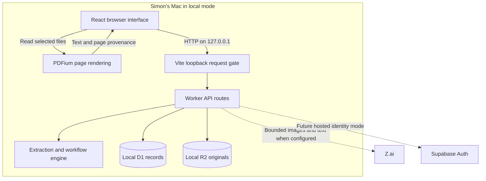
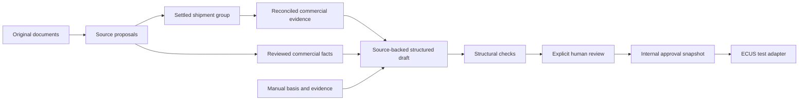
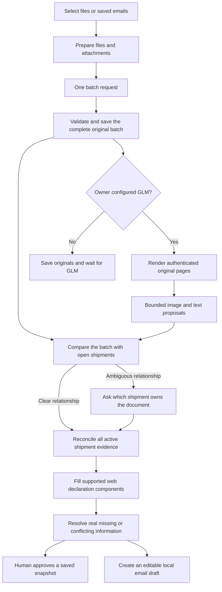

# Understanding the AICD code and architecture

**Updated October 11, 2026:** Chapter 20 explains the simpler navigation and source structure. Chapter 21 follows the new shipment-first intake, grouping, autofill and targeted-question workflow through the actual code.

This guide explains the application in this repository, how its parts cooperate, and the engineering reasons for the design. It assumes experience with AI training but no software development experience. Examples are synthetic. File links are relative to this guide so they also work in an extracted source download.

AICD is a document review application with owner-configured AI assistance. Its central distinction is between **what a document says**, **what software proposes**, and **what a person has reviewed**. Keeping those separate lets a reviewer inspect disagreements and prevents an extraction result from silently becoming a customs decision.

The current local application has local and browser PDF page rendering, GLM-5.3-Flash extraction, batch intake, document grouping before declaration autofill, targeted questions, local editable email drafts, audit history, bilingual reports and a simulated ECUS handoff. When the owner configures the server, GLM reads rendered original pages after upload without PDF text extraction or OCR, and GLM can associate imported emails with current shipment evidence. Gmail synchronization, email sending, scheduled follow-ups, a real ECUS connection and executable verified customs rules are still absent. The existing Supabase password adapter is retained for standalone testing; the selected product direction is Google sign-in plus owner approval, still to be implemented. Local use does not require a login.

## 0. Connect this to what you know about AI

In model work, you distinguish input data, predictions, labels, evaluation and model versions. Similar distinctions help here, although they serve an application rather than a training loop:

| Familiar AI concept | Closest AICD concept | Important difference |
| --- | --- | --- |
| Raw example | Original document bytes and page text | A document is evidence, not automatically a true statement. |
| Prediction | An extraction `Candidate` | New automated document facts come from GLM inference; older records retain their original provenance. |
| Checked annotation | A human `ReviewedValue` | It is an accountable workflow decision, not automatically a training label. |
| Evaluation checks | Software issues and test fixtures | Current checks do not establish broad extraction accuracy. |
| Versioned experiment artifact | An approval `Snapshot` | It freezes a particular reviewed shipment and evidence, not model weights. |
| Inference service | The owner-configured GLM API | The pipeline sends bounded page images or source-file text and validates source-linked proposals. It does not train or fine-tune GLM. |

There is no automatic learning from corrections in this code. A correction is saved to the case and audit history. Per-client correction memory and any future dataset promotion need separate design, permission, isolation and evaluation. More reviews do not currently update model parameters or parser rules.

Most AICD code is ordinary software. It has to answer questions such as: Where is the original file? Which version did this person review? Did another tab already change the case? Is this request allowed? What should the screen show while a request is running? A more capable language model does not remove those responsibilities.

### What a source file contains

A **variable** holds a value. An **object** groups named values, such as `{ page: 1, text: "Invoice..." }`. An **array** holds several values, such as a list of pages. A **function** is a named operation that accepts inputs and produces a result or performs work.

For example, this simplified teaching function is ordinary deterministic code:

```ts
function normalizeCurrency(raw: string): string {
  return raw.trim().toUpperCase();
}
```

`function` introduces an operation. `normalizeCurrency` is its name. `raw` is the input variable. The first `: string` says the input should be text; the second says the output should be text. Curly braces surround its body. `trim()` removes surrounding whitespace, `toUpperCase()` capitalizes letters, and `return` gives the result back to the caller. Calling it with `" usd "` returns `"USD"`. It does not learn, ask a model or validate a currency code. AICD's real normalizer is more cautious and records its changes.

`import` lets one file use something exported by another file. `export` makes a value, type or function available to other modules. A path starting `@/` means the repository root because `tsconfig.json` defines that shortcut.

`if` chooses a branch. `throw new Error(...)` stops the normal path with a failure. `try`/`catch` lets a caller convert that failure into a useful response. `.map(...)` creates a transformed array, `.filter(...)` keeps matching entries, and `.find(...)` selects the first match. These operations appear frequently in evidence and issue processing.

`async` means a function may wait for work such as a network or database request. `await` waits for that result without treating it as already available. A **Promise** represents an eventual success or failure. This is why the UI needs loading and error states: an API response is not immediate or guaranteed.

| File ending | What you are reading |
| --- | --- |
| `.ts` | TypeScript logic and types. |
| `.tsx` | TypeScript that can also describe UI elements with JSX. |
| `.mjs` / `.mts` | JavaScript/TypeScript modules, often used by launch/build tooling here. |
| `.css` | Rules for colors, spacing, layout and responsive behavior. |
| `.sql` | Database commands or migrations. |
| `.json` | Structured data/configuration. |
| `.py` | Python utility scripts, familiar if your training work used Python. |
| `.md` | Human-readable documentation. |

JSX looks like HTML inside JavaScript. In `<button onClick={save}>Save</button>`, the button label is `Save`, and clicking calls the `save` function. React components are functions that describe portions of the screen. They do not contain a model's learned behavior.

### How a click becomes a saved decision

This is an illustrative request, not the full production handler:

```ts
const response = await fetch("/api/workspace", {
  method: "POST",
  headers: { "Content-Type": "application/json" },
  body: JSON.stringify({
    revision: 12,
    action: {
      type: "review_field",
      caseId: "case_example",
      field: "invoiceNumber",
      value: "INV-001",
      reason: "Checked against invoice page 1."
    }
  })
});
```

`fetch` sends an HTTP request from the browser. The path selects the application endpoint. `POST` requests an operation; `GET` retrieves information. The content-type header tells the server how to interpret the body. `JSON.stringify` turns a JavaScript object into JSON text. The action describes the requested change. The revision identifies which saved workspace the browser was looking at.

The backend independently determines who sent it, checks membership and validates the action. If it succeeds, it returns the updated workspace. The browser then updates React state and redraws the screen. The browser cannot simply claim that a review was saved.

HTTP status codes communicate the broad result: `200` means success, `400` invalid input, `401` missing/invalid authentication, `403` denied access, `404` unavailable record, `409` a revision conflict, and `422` an action that does not fit the current workflow. Detailed error text tells the user what to do next.

When reading a function, first ask: What does it receive? What does it return? Does it change state, write a file/database, or call another service? What can fail? Those four questions are more useful initially than memorizing every syntax detail.

## 1. Vocabulary and the actual technology stack

The **frontend** is the code running in your browser: buttons, forms, source viewers, pending edits and PDF page rendering. The **backend** is the code serving authenticated requests, checking permissions, applying workflow changes and saving records. Both run on your Mac in local mode, but they are different execution environments. Browser code cannot safely hold a secret merely because the backend is on the same computer.

An **API** is the agreed interface between those environments. Here it consists of HTTP routes such as `GET /api/workspace` and `POST /api/documents`. **JSON** is the text format used to send structured objects. File uploads use multipart form data because they contain binary bytes as well as metadata.

| Technology | What AICD uses it for | Why this choice fits this implementation |
| --- | --- | --- |
| TypeScript | Application types and most business logic | Finds many incompatible values and missing properties before running the program. It does not validate arbitrary incoming JSON by itself. |
| React | Rendering the interactive interface | A component describes the screen for the current state; changing state updates the screen. |
| Next-style App Router conventions | `app/page.tsx`, `app/layout.tsx`, `app/api/**/route.ts` | Gives pages and API endpoints familiar file locations. |
| Vite and Vinext | Development server and framework build | This checkout runs the App Router application through Vinext/Vite. `next` is present, but `npm run local` is not simply `next dev`. |
| Cloudflare Workers runtime | Backend request handlers | The local emulator and hosted path share the Worker APIs and storage bindings. |
| D1 / SQLite | Workspace records, memberships and authentication metadata | SQL supports conditional, atomic updates and uniqueness constraints. |
| R2 object storage | Original PDFs, images and emails | Large original files belong outside the database's JSON record. Local mode emulates this on disk. |
| Zod | Runtime input and provider response validation | Network inputs remain untrusted even when the app itself is written in TypeScript. |
| PDFium | Rendering PDF pages into images for GLM | Rendering draws the original page; it does not recognize text or fill form values. |
| pdf-lib and fontkit | Generating downloadable reports | The app controls pagination and embeds a font that supports Vietnamese. |
| PostalMime | Reading saved `.eml` messages | MIME messages need a parser; attachments cannot reliably be recovered with simple text splitting. |

See [package.json](../package.json) for exact installed dependency ranges and commands. The lockfile records the resolved installation. Some packages and UI components came with the application scaffold and are not used by the main shipment screen. Their presence is not evidence that AICD has those features.

## 2. Architecture



This is a **modular monolith**: one application contains several modules with distinct responsibilities. It is not a collection of independently deployed microservices. That reduces setup and coordination work for a pilot. The file boundaries still make extraction, identity, storage and handoff replaceable without putting everything in one function.

The most important boundaries are:

1. The browser supplies input, but the backend checks identity, membership, permitted actions and revision numbers.
2. The domain engine determines whether an action is valid. Hiding a button is not permission enforcement.
3. Original bytes are stored separately from interpreted text and reviewed values.
4. GLM returns suggestions, not trusted application actions.
5. Internal approval and the test ECUS result never become official customs approval.

The local launcher runs a durable SQLite page-job queue with two originals in parallel, and matches imported emails after their documents finish. It continues while the server runs, including with the browser closed. Hosted standalone extraction remains request-driven. There is no live collaboration socket; other sessions' edits are detected when a save meets a newer revision.

## 3. Startup from the first command

Run:

```sh
cd /Users/simon/Documents/ChatGPT/Calendar/aicd
npm run local
```

`npm` looks up the `local` entry in [package.json](../package.json), which launches [scripts/local.mjs](../scripts/local.mjs).

The launcher performs these steps:

1. Parses the optional port. It accepts a loopback port override, not an arbitrary public host or deployment arguments.
2. Calls [local-instance.mjs](../scripts/local-instance.mjs) to check that the port is free and reserve this workspace using a process lock. The check happens before writing configuration. Otherwise a second launch could rotate the first server's internal token.
3. Calls [local-config.mjs](../scripts/local-config.mjs) to create private local configuration and a random per-launch proof. The directory uses permission `700`; private files use `600`.
4. Keeps only explicitly allowed GLM settings from the private local secrets file or administrator-supplied `ZAI_API_KEY` / `ZAI_MODEL` environment overrides. It saves those Worker secrets, then removes provider values from the Vite process environment. Hosted identity settings and root environment files remain excluded.
5. Applies database migrations with Wrangler's explicit `--local` flag.
6. Starts Vite at `http://127.0.0.1:5173` with a strict port. If the port is occupied, it fails instead of silently changing the address.

[vite.config.ts](../vite.config.ts) selects the runtime, plugins and storage bindings. In local mode it disables remote bindings, tunneling and connector preview, isolates environment loading, and denies web access to secret and state paths. [build/local-vite-plugin.ts](../build/local-vite-plugin.ts) checks the socket address, Host and Origin, rejects caller forwarding headers, removes any caller-supplied proof and inserts its own internal proof.

[lib/local-auth.ts](../lib/local-auth.ts) checks that proof again inside the Worker, along with the development-only build flag. This is defense in depth: setting `AICD_AUTH_MODE=local` on a production deployment is insufficient to enable local access.

Local mode represents one actor, `Local owner (this Mac)`. It is not a password-protected multi-user service. Any local process able to reach this Mac's loopback listener can use that actor, including a process belonging to another local OS user. The HTTP gate does not check the operating-system user ID; filesystem permissions separately restrict direct access to saved files. Stored state is under `.aicd-local/state/`; source code is not the same thing as saved shipment data. See [local setup](local-setup.md) for backup and GLM configuration details.

## 4. The data model is the foundation

Start reading code at [lib/types.ts](../lib/types.ts). A TypeScript `type` describes the shape of an object. A union such as `'review' | 'approved' | 'completed'` limits the allowed status values. A `Record<string, ReviewedValue>` is a dictionary whose keys are field names and whose values are review records. A question mark marks an optional property.

| Type | Meaning | Why it is separate |
| --- | --- | --- |
| `WorkspaceState` | Cases, documents, candidates, audit entries, emails, local email drafts, snapshots, handoffs and settings | The current pilot saves these as one versioned aggregate. |
| `ShipmentCase` | One shipment review workflow | Documents are evidence belonging to the case; the case also has review status and decisions. |
| `ShipmentDocument` | One stored document version | Preserves filename, hash, active status, pages, source email and extraction status. |
| `SourcePage` | Text and provenance for one physical page | A combined PDF can contain different document types on different pages. |
| `Candidate` | One software-proposed field value | Multiple candidates can disagree without overwriting one another. |
| `ReviewedValue` | A person's selected or entered value | Records source, reason, reviewer, time, staleness and unverified status. |
| `GoodsLine` | A proposed or reviewed commercial line | Separates description/quantity/price from manual customs decisions. |
| `Issue` | A current problem derived from evidence and review state | Problems can change when evidence changes. |
| `IssueResolution` | A person's disposition of a particular issue fingerprint | A previous explanation should not silently resolve changed evidence. |
| `AuditEntry` | Who changed what, when and why | Preserves the workflow history and before/after details. |
| `EmailRecord` | Original message metadata, available plain body text and attachment relationships | A reply can exist without a new document or shipment. |
| `EmailShipmentMatch` | An evidence-backed correspondence association or review suggestion | Stores quotations, status, source versions and whether a person made the decision. |
| `EmailDraft` | Editable questions saved inside AICD | A local draft is separate from a delivered message or a Gmail draft. |
| `Snapshot` | A copied approved version with its evidence and issues | Handoff needs a stable version even if the working case changes later. |
| `HandoffRun` | One test connector attempt against a snapshot | Failure/retry history should not be mixed into the declaration itself. |

A simplified candidate might look like this:

```ts
const candidate = {
  field: "invoiceTotal",
  value: "1250.00",
  originalText: "Invoice total: 1,250.00",
  documentId: "doc_example",
  documentVersion: 1,
  page: 1,
  location: "Line 8",
  method: "deterministic_label",
  confidence: "high",
  normalizations: [
    { before: "1,250.00", after: "1250.00", reason: "Explicit numeric format" }
  ]
};
```

This example omits some required properties for readability. The real type also includes IDs and case linkage. Notice that the number remains a string: original formatting, blank input and ambiguous text need to survive until review. Converting every value to a JavaScript number immediately would discard that information.

`Action` is a **discriminated union**. Every command has a `type`, and each type has its own required payload. For example, `review_field` needs a case, field, value and reason, whereas `approve` needs a case ID. This is clearer than accepting an arbitrary replacement workspace from the browser.

TypeScript checks trusted source code during development. [server-validation.ts](../lib/server-validation.ts) checks the actual request at runtime. Both are necessary.

## 5. Follow one upload batch through the whole system

The upload handler in [app/page.tsx](../app/page.tsx) receives browser `File` objects. It calls [prepareIntakeFile](../lib/client-intake.ts) for every selected file, presents progress and allows cancellation. That routine uses `prepareFile` for ordinary supported files and for supported attachments inside a saved email. Once the complete selection is prepared, the browser sends all original files, matching page metadata and the expected workspace revision to `/api/documents` in one request.

For TXT/CSV, the browser reads source text and treats form-feed characters as page breaks. For PDFs, the server counts physical pages and PDFium checks that count before rendering page images; it does not extract the hidden text layer or recognize words. Images likewise wait for GLM. After originals are saved, the browser prepares authenticated page images and asks the configured server to run GLM. Text files also use GLM to produce form facts. See [the extraction pipeline](kimi-vision.md) for the current sequence.

The route delegates to [lib/server-upload.ts](../lib/server-upload.ts). The backend:

1. Checks same-origin access, identity and workspace membership.
2. Bounds the incoming byte stream, parses the multipart body and validates the expected revision.
3. Sanitizes filenames and checks supported file signatures rather than relying solely on a filename extension.
4. Computes SHA-256 from the original bytes and checks duplicates.
5. Validates page metadata. For PDF files it independently checks the physical page count with `boundedPdfPages`.
6. Stages original files and emails in R2 under server-derived workspace/object keys.
7. Runs eligible GLM extraction for text sources when the owner configured it; PDF/image reading happens after originals are saved. Without GLM, the original remains saved in a pending state.
8. Creates one internal intake action containing all prepared documents and emails. The engine groups the complete batch against existing open shipments, then reconciles facts and fills supported fields only for settled groups.
9. Conditionally commits the resulting workspace in one D1 revision change.

If a later operation fails, the handler attempts to delete newly written R2 objects. D1 and R2 are separate stores, so this is compensating cleanup, not a single atomic transaction across both systems. A future production system needs reconciliation for failed cleanup and orphaned objects.

Original bytes are preserved, but the server does not independently prove that the browser-rendered pixels match those bytes. It checks the fingerprint, image structure, source version and page boundaries. The original viewer remains available for checking source evidence.

### Rendering is different from extraction

A PDF describes what to draw on a page. [lib/pdf-pages.ts](../lib/pdf-pages.ts) counts physical PDF pages on the server. [lib/pdf-raster.ts](../lib/pdf-raster.ts) uses PDFium to draw each page as an image in a browser worker managed by [lib/client-pdf-raster.ts](../lib/client-pdf-raster.ts). This preserves the visible labels, tables, stamps and layout that GLM needs. PDFium is not used to select or recognize the document's words.

PDF.js, Tesseract, OCR workers and language data have been removed from the active pipeline. [client-intake.ts](../lib/client-intake.ts) prepares page metadata and attachments. [client-vision.ts](../lib/client-vision.ts) renders authenticated saved pages, sends them through the server to GLM, and saves progress. GLM supplies page classification, clarity and field extraction. The Documents panel shows the original file. Saved quotations remain in field evidence; there is no extracted-text tab.

For a clear reading with valid source evidence and no contradiction, the application fills the draft without a routine confirmation question. It still asks about missing, ambiguous or conflicting information and keeps final approval human. If a page cannot be read, the system preserves the original and the unfinished work rather than silently switching to a second extractor.

The current limits are 20 top-level files per request, 20 MiB and 50 pages per file, and 22 MiB for the entire multipart request including metadata. Client text intake and server text validation have their own bounds. These limits contain memory and runtime costs; they do not establish document accuracy. A batch of individually valid files can still exceed the total request limit.

### Saved emails share document preparation

For `.eml` input, the browser uses PostalMime to find attachments and prepares each supported attachment with the same file preparation routine used for direct uploads. The backend parses the original email independently and matches submitted attachment metadata by name and attachment index. It preserves message and attachment bytes, sender, subject, timestamp, message ID, available plain body text, reply headers and relationships. Duplicate message IDs or hashes prevent duplicate messages, and attachment hashes identify reused files. Each email may contain up to 50 attachments. A reply without attachments can also be saved: correspondence does not need a new document or an empty shipment case.

Unreadable and unsupported attachments are retained with a visible problem instead of disappearing. A raw API upload does not acquire a hidden OCR service. Supported PDF/image originals can subsequently be processed through the browser vision action: PDFium renders their physical pages, and GLM reads the resulting images. Unsupported files still require another readable representation or manual entry.

There is no Gmail OAuth or synchronization implementation yet. Setting an inbox address records intended configuration; it does not connect the inbox. Generic connector scaffolding is also not a Gmail integration.

### Matching correspondence after documents are grouped

Email matching adds a different relationship from document grouping. An email with two shipments' attachments may appear in two cases; a follow-up without attachments may belong to one existing case. Automatically moving every attachment to one AI-selected case would lose this distinction.

[lib/email-shipment-ai.ts](../lib/email-shipment-ai.ts) builds a bounded text context from email subjects/bodies and current document identifiers. It asks the fixed server-configured GLM API for structured proposals, then checks exact email quotations, document quotations, reference roles, source versions and ambiguity. A distinct reliable House B/L or unqualified B/L reference, or an invoice reference supported by a different contract/container reference, can justify automatic linking. Weak or ambiguous evidence produces a review suggestion. Shared senders and conversational similarity alone do not justify a link. Historical sample collections and completed cases are excluded from new AI matching.

[lib/email-grouping.ts](../lib/email-grouping.ts) saves these proposals as `EmailShipmentMatch` records. A source replacement or move can make a match stale. A reviewer confirms or rejects one suggestion at a time; later model runs preserve that human decision. The action changes correspondence associations, not declaration values, document assignment or approval status. This is why there is a separate match record instead of treating the model response as a request to merge cases.

[lib/server-email-grouping.ts](../lib/server-email-grouping.ts) checks access and the expected workspace revision, shares the extraction rate limit, and handles up to eight emails in one provider pass. Matching runs after saved-email intake when configured, and the **Emails by shipment** card can resume processing existing messages. Original intake is already committed when matching starts; failure leaves the message and files available. The UI shows exact source excerpts beside uncertain suggestions and folds linked/rejected records below them. See [the email matching guide](email-shipment-grouping.md) for limits, file responsibilities and examples.

## 6. Extraction creates evidence, not decisions

New automated document facts come from [lib/kimi.ts](../lib/kimi.ts). It asks the model for a bounded structured response and validates each source-linked proposal. GLM reads PDF/image content visually and reads supported text-based files from their prepared source text.

[lib/extraction.ts](../lib/extraction.ts) contains shared normalization and helpers that read saved document-type metadata. The historical heuristic reader exists only in test fixtures. Uploads and explicit transcriptions wait for GLM; provider failure never activates a local field parser.

| Function or structure | Responsibility |
| --- | --- |
| GLM request and response schemas | Bound the request and define permitted facts and evidence. |
| Page reading and type metadata | Preserve what GLM read and distinguish invoice, packing and transport pages. |
| `normalizeValue` | Apply limited, recorded formatting transformations. |
| Exact-decimal integrity helpers | Check unambiguous numbers and arithmetic without inventing values. |
| Shipment reconciliation | Compare the same fact across its sources before filling the draft. |

Normalization is deliberately narrower than correction. Removing repeated whitespace or converting `2026/10/10` into `2026-10-10` preserves an unambiguous meaning. `03/04/2026` could mean two different dates, so the normalizer leaves that ambiguity for review. A three-letter currency token can be uppercased without claiming it is a verified legal code.

Transport roles need special handling. A carrier's consignee is not necessarily the commercial importer. House B/L and master B/L parties and identifiers are kept separate. Packing package counts also must not silently become commercial goods quantities. The extraction tests contain counterexamples for these distinctions.

The application does not infer customs procedure, tax or tariff decisions. Explicit source HS digits or an explicit two-letter origin token can be retained in an unverified declaration draft; neither is a validated customs classification. Explicitly printed customs fields may be retained without inference. A supported explicit country name can map to its code through the application's reference table, with the original reading and normalization reason retained. A supplier's statement is not proof of regulatory eligibility.

## 7. The workflow engine

[lib/engine.ts](../lib/engine.ts) is the main business module. It knows about shipments and decisions, not HTTP responses or SQL connections. That makes it possible to test workflow rules without starting the website.

`applyAction(original, action, actor)` starts with `structuredClone(original)`. It updates the copy and returns it. If validation throws, the caller still has the original state. This resembles a reducer: old state plus a command becomes new state. It is not mathematically pure or fully deterministic because it also creates timestamps and UUIDs.

The API remains responsible for authenticating the actor. Passing an `Actor` to the engine does not itself establish identity.

### Grouping

`groupShipmentDocuments` in [lib/shipment-grouping.ts](../lib/shipment-grouping.ts) receives profiles for the complete batch and existing open cases. Each profile contains reference sets, commercial/transport context, container sets and explicit container/seal pairs. It links strongly supported matches, combines their evidence, and checks again. This lets a packing document connect an invoice to a bill without depending on upload order.

Different House B/L numbers or conflicting unqualified B/L numbers prevent an automatic join. A common master bill, contract, sender, vessel or company alone is insufficient. Low-confidence identifiers cannot independently merge cases. Grounded GLM facts can corroborate other evidence, but do not override those rules. A clear evidence-linked group may set `groupingConfirmed` automatically; an ambiguous group stays separate and requires a person's confirmation. That flag records settled grouping, not human sign-off on every declaration field.

`regroupDocuments` in the engine applies the result. Merged cases retain their history and a `mergedInto` pointer rather than disappearing. An existing shipment selected in the UI does not force unrelated new attachments into it. Manual move/merge operations remain available for an explicit reviewer decision.

### Reconciliation and issues

`getProposedFields` prefers a non-stale reviewed value. Otherwise it proposes a value only when active evidence has one distinct interpretation. It does not pick one of two contradictory invoice totals.

[lib/shipment-autofill.ts](../lib/shipment-autofill.ts) then reconciles the whole shipment and maps supported facts to typed declaration components. It compares exact decimal values, treats container lists as sets, leaves unknown components blank, and records the source document/version/page/quote. It does not add repeated invoice totals from multiple documents. Autofill returns without changing the declaration while grouping is unresolved.

`getIssues` derives current findings from the case: missing pilot documents, conflicts, unreadable pages, uncertain extraction, unconfirmed grouping, stale decisions, goods problems and failed test handoffs. Missing-information questions wait until all available documents have readable extraction results. Clear source-backed draft entries do not each create a routine confirmation question. Actual conflicts, absent units, invalid dates and broken provenance remain actionable. The checklist is a software review policy, not a verified statement of legal requirements.

Issue resolutions contain a fingerprint of relevant evidence. If the evidence changes, an old resolution no longer automatically matches. The fingerprint is a change detector; it is not a cryptographic signature.

Arithmetic checks now use [lib/integrity.ts](../lib/integrity.ts), which represents a decimal as an integer coefficient and a scale. For example, `12.345` becomes coefficient `12345n` and scale `3`. The `n` means a JavaScript `BigInt`, an integer without ordinary floating-point rounding. Comparing, adding and multiplying these pairs preserves exact decimal values. Original strings remain unchanged. A value such as `1,234`, `1e3`, `.5` or `12x` is rejected as ambiguous or malformed rather than silently converted. Package counts use the integer form. Dates are checked against calendar month lengths and leap years, including the packing-list date.

Quantity × unit price and line totals are compared exactly. There is no universal rounding allowance. A reviewer can explain a genuine rounding, discount or charge discrepancy through the existing reasoned resolution path. This detects numerical inconsistency; it does not establish currency-specific accounting, customs valuation or tax correctness. A malformed supplied unit price is a separate issue and cannot be dismissed as an arithmetic difference.

### Reviewing, replacing and approving

`review_field` checks the field definition, candidate relationship and reason, records the actor/time, and invalidates any previous approval. `review_goods` checks line provenance and captures manual changes with reasons. These actions record decisions; they do not grant legal validity to customs fields.

Later agreeing attachments preserve existing manual decisions and reviews. Changed supporting values flag affected decisions, and changes to an approved document set clear the working approval without rewriting the earlier snapshot. Repeating an unchanged grouping or goods confirmation does not invalidate unrelated declaration decisions. Explicit replacement/transcription/classification still uses a broader conservative invalidation path: replacement keeps the old document inactive and creates a version linked by `replacesId`. Those edit paths can require more re-review than ordinary later attachments.

`approve` checks the current blocking issues, assigns a snapshot ID and copies the reviewed declaration, documents, candidates and issues into a snapshot. A snapshot is independent of later working edits. It is not a cryptographically sealed or externally certified record.

Audit payloads are copied when appended so later changes to a reviewed object cannot rewrite earlier before/after details. The regression test covers this object-reference hazard. The database and application still control these records; they are not an append-only external ledger.

`complete` records a responsible user and reason, then moves the case to the archive. `reopen` returns it to review for amendments. Completed is a workflow status, not evidence of customs clearance.

## 8. Why two simultaneous saves do not silently overwrite each other

[lib/server-persistence.ts](../lib/server-persistence.ts) implements **optimistic concurrency**. A request carries the workspace revision that the browser last saw.

Simplified SQL:

```sql
UPDATE workspaces
SET state_json = ?, revision = ?, updated_at = ?
WHERE id = ? AND revision = ?
  AND EXISTS (/* membership for the authenticated actor */);
```

Suppose two tabs both loaded revision 12. The first update changes 12 to 13. The second update still requires revision 12, so it changes zero rows. AICD returns HTTP 409 with the newer workspace rather than silently discarding the first change.

[lib/server.ts](../lib/server.ts) first checks the expected revision for a useful early error, then the SQL condition enforces it atomically at commit time. Both checks matter: another request can arrive between the first check and the final write.

The main frontend also serializes its ordinary action saves with a Promise queue and retains pending input on a conflict. That helps one tab submit in order, while the server condition protects all tabs and users.

The limitation is the scope of the revision/conflict boundary: every change uses the whole workspace revision. Edits to two unrelated cases can conflict. This is manageable for a pilot; larger teams need per-case concurrency and normalized storage.

## 9. Storage and API responsibilities

[db/schema.ts](../db/schema.ts) describes four SQL tables:

| Table | Contents |
| --- | --- |
| `workspaces` | ID, owner ID, revision, JSON state and timestamps. |
| `workspace_members` | Workspace/email membership, linked identity, owner/reviewer role and invitation metadata. |
| `auth_rate_limits` | Atomic authentication and model request counters with expiry. |
| `auth_recovery_grants` | Hashed session-bound, short-lived password setup/recovery proofs. |

The `drizzle/` SQL files create those tables and indexes. Migration names are generated labels, not business concepts. [db/index.ts](../db/index.ts) provides a Drizzle wrapper, but the main AICD server uses prepared D1 SQL directly where conditional commits and transactions need to be explicit.

The workspace JSON is capped at 1.8 MB. Storing the whole aggregate is simple and makes workflow commits easy to reason about. It also means snapshots and audit history increase one row's size, reads return broad workspace data, and there is no scalable case pagination yet.

| API route | Purpose |
| --- | --- |
| `GET /api/workspace` | Authenticate, find membership, load state and derive issues. |
| `POST /api/workspace` | Validate an allowed action and revision, apply it and commit. |
| `POST /api/documents` | Preserve originals, process a complete batch and group before autofill, or replace one document. |
| `GET /api/documents/:id` | Read an original document after workspace authorization. |
| `GET /api/emails/:id` | Download an authorized original email. |
| `GET/POST /api/team` | Read memberships or grant reviewer access in a shared deployment; local invitations are denied. |
| `GET /api/auth/status` | Return safe mode/configuration/session information. |
| `POST /api/auth/login`, `/refresh`, `/logout` | Hosted email/password session lifecycle. |
| `POST /api/auth/reset-password`, `/verify`, `/password` | Hosted invitation/recovery and password setup flow. |
| `GET /api/ai/status` | Report whether GLM settings exist; it is not a live provider health test. |
| `POST /api/ai/extract` | Bounded selected-page GLM extraction with stored text and available vision evidence. |
| `POST /api/ai/vision-page` | Validate and privately store a page image bound to an authenticated original/version. |

Most `route.ts` files are short adapters. [server.ts](../lib/server.ts) centralizes private response headers, error handling, bounded JSON reading, membership, revision checks and persistence. [server-validation.ts](../lib/server-validation.ts) centralizes strict Zod schemas and file checks. Invalid input gets a controlled error rather than a stack trace with internal details.

[server-download.ts](../lib/server-download.ts) accepts a record ID, then looks up the object key inside the authorized workspace. It does not accept an arbitrary storage key from the caller. Downloads have private cache headers, a restrictive document policy and safe content-disposition names. File signature checking is not malware scanning.

## 10. Authentication and the email/password question

The repository has two supported identity adapters and a fail-closed unconfigured state. The old hosting-gateway identity adapter has been removed.

| Mode | Who identifies the user? | Intended use |
| --- | --- | --- |
| `local` | The development-only loopback gate returns one fixed local actor. | Single-user work on this Mac. |
| `supabase` | Supabase verifies the password/session and confirmed email; AICD checks membership. | Future invite-only hosted email/password access. |
| Unconfigured | Nobody is authenticated. | Generic builds deny data access until an explicit provider is configured. |

Local use requires no login. The intended team login is Continue with Google, followed by owner-approved workspace access. That flow will replace the current password-oriented onboarding in a later implementation step. Gmail mailbox permission and ECUS credentials remain separate connection steps.

In the hosted email/password flow, [auth-handlers.ts](../lib/auth-handlers.ts) validates a small same-origin HTTPS request, applies rate limits, sends credentials to Supabase, checks the returned identity and allowlist, and writes secure cookies. AICD does not implement a password database or password hashing system.

[auth-provider.ts](../lib/auth-provider.ts) validates provider configuration and response shapes, bounds response bodies, refuses redirects and returns sanitized errors. Session cookies are `HttpOnly`, `Secure`, `SameSite=Lax` and `__Host-` scoped. `HttpOnly` prevents ordinary browser JavaScript from reading tokens; it does not make arbitrary injected JavaScript harmless. HTTPS and the rest of the application's controls still matter.

[auth-persistence.ts](../lib/auth-persistence.ts) uses SQL statements that check and increment limits atomically. It binds invitation/recovery permission to a hashed token and actor, consumes it once and limits its lifetime. [app/auth/callback/page.tsx](../app/auth/callback/page.tsx) handles account links without automatically consuming them merely on page load.

[auth-client.ts](../lib/auth-client.ts) retries an API request once after a successful session refresh. A shared pending refresh Promise avoids several simultaneous failed requests all refreshing independently. Tokens stay in cookies, not JavaScript local storage.

Authentication answers **who are you?** Authorization answers **may you access this workspace?** A valid Supabase account alone is not enough. An invited address needs a matching AICD membership, and an existing linked identity is not automatically reassigned just because an email matches.

Email/password can be an appropriate design with a configured provider, HTTPS, membership controls, throttling and recovery safeguards. This source contains those mechanisms, but a live provider, email delivery and deployed session behavior still require end-to-end testing. The current local mode makes a different tradeoff: convenient single-user access protected by the local machine boundary.

## 11. GLM integration and its trust boundary

The current pipeline uses **GLM as its only document extractor**. PDFium only prepares page images; PDF.js and OCR are removed from the active path. Read [GLM vision extraction](kimi-vision.md) for the full beginner explanation, data flow and administrator setup. The owner supplies the server key; users have no API-provider settings. The live model is `glm-5.3-flash`, with low reasoning effort and no Moonshot fallback. `kimi.ts` and related internal names are preserved for stored-evidence compatibility.

[lib/client-vision.ts](../lib/client-vision.ts) downloads the authenticated original, verifies its SHA-256 fingerprint, and renders physical pages using PDFium without reading a PDF text layer. Images are uploaded in bounded form to [lib/server-vision.ts](../lib/server-vision.ts). [lib/vision.ts](../lib/vision.ts) checks JPEG dimensions and derives storage keys tied to the workspace, document version, original fingerprint, page and image fingerprint. This manual/hosted browser path needs an open tab. The local automatic reader uses PDFium and Sharp independently and continues while the local server is running.

[lib/server-kimi.ts](../lib/server-kimi.ts) checks identity, membership, revision, active document and case state. It loads the private page images and server-only key, then applies the workspace request limit. [lib/kimi.ts](../lib/kimi.ts) sends those images to the fixed endpoint `https://api.z.ai/api/paas/v4/chat/completions`. There is no arbitrary external-image URL supplied by the browser.

GLM is asked to return page readings, clarity, document types, factual header values and commercial goods proposals as JSON. Goods cells share a `rowIndex` only when they belong to the same physical row. The prompt treats printed instructions as untrusted document content and prohibits inferring customs procedure, tax or tariff decisions; only explicit source fields are permitted. The model receives no action tools. Runtime code additionally checks:

1. The provider response is bounded, complete and valid JSON.
2. Each proposal fits the schema and allowed field set.
3. The selected source page and current document version exist.
4. Text-only quotes and values occur in the stored text.
5. A visual reading is bound to a supplied page image and valid region, with its quotation retained as the model's reading.
6. Normalization uses conservative application rules, with evidence retained through grouping and draft autofill.

A clear, source-backed result can fill the draft automatically without an individual confirmation. Uncertain or contradictory facts remain questions. The saved result is not a human review or an independently verified fact. Text occurrence does not prove that the model assigned the correct role, and a valid image region does not prove that the model read it correctly. Source fingerprints identify the bytes used; the server does not independently re-render every PDF to prove the browser's pixels are truthful. The original viewer and final human review remain part of the trust boundary.

The general workspace action endpoint cannot accept arbitrary caller-created AI candidates. The specialized extraction endpoint constructs the internal action after validation. Source-version and workspace-revision checks prevent stale output from silently overwriting newer evidence or review decisions.

Each request is bounded to 5 pages, 24,000 text characters, 500 proposals and 24,000 output tokens. Visual processing uses one page per call; up to five selected text pages may share a request. Each page raster is capped at 2,600 pixels per side and 1.5 MiB. Six provider calls are allowed per workspace per minute. Successful batches save their completed pages; a later failure or rate limit can leave a partial document, which the extraction action can resume. Processing completion is not a field-accuracy claim.

Without a key, originals are saved and wait for GLM. There is no PDF text/OCR/deterministic fallback. Provider errors preserve originals and completed batches. Timeouts are not blindly retried; the provider may have already charged for work in progress. A configured status and mocked tests do not establish live provider access or accuracy. No model result can approve the draft, send email or transmit a customs declaration.

Email matching uses the same server key and fixed endpoint in a separate text request. Its context contains saved email text and shipment-reference evidence, including references produced during vision extraction; it does not resend all PDFs. The planner's proposals pass strict source checks before the server creates an internal match action. A single pass is limited to eight emails, and omissions are reported rather than presented as a complete inbox review. Matching checks use controlled provider responses. Document-image benchmark scores do not measure email-matching accuracy, which requires broker-reviewed correspondence.

## 12. React screen state and saving

[app/layout.tsx](../app/layout.tsx) defines the document shell, metadata and global stylesheet. [app/page.tsx](../app/page.tsx) is a client component containing the current workspace screen and most interaction orchestration.

`useState` stores values that affect rendering: the current workspace response, selected case, selected document/page, active tab, search, modal, errors and pending edits. `useRef` holds values that need to survive renders without independently triggering a render: latest server state, the save queue, upload cancellation and pending saves. `useEffect` performs work tied to lifecycle or state, such as loading the workspace, cleaning up a request and expiring a toast.

The distinction between server data and local drafts is intentional. A user can type while a request is in flight. When that request finishes, the response must not erase a newer edit that was typed after the request started.

Header field saving captures the submitted value and clears the draft only if the current draft still equals that submitted value. [client-drafts.ts](../lib/client-drafts.ts) applies the same idea to goods arrays, using the submitted array's identity. [client-reviewer.ts](../lib/client-reviewer.ts) prevents a freeform assignee name from pretending to be a second local actor.

Some field saves occur on blur, meaning focus leaves the input, or when the adjacent check button is clicked. The review reason must already be supplied. Goods review has an explicit save operation. There is no durable per-keystroke offline draft store. Unsaved edits may survive navigation within this mounted screen but can be lost on reload or closing the tab. Do not confuse “saved server state persists” with “every keystroke is saved.”

The screen disables approval, report export and handoff while the selected case has pending drafts. Otherwise the user could see a new unsaved value on screen while approving an older saved value.

The source panel and field/issue panels are connected by candidate document/page references. Clicking evidence changes the selected document and page. `proposed` avoids showing a single default value when active candidates disagree.

[components/account-access.tsx](../components/account-access.tsx) owns status loading and sign-in/recovery forms. [components/declaration-draft.tsx](../components/declaration-draft.tsx) owns the structured declaration editor. They use the shared locale context. The declaration layout follows the vendor's broad General information 1 / General information 2 / Goods organization; matching those headings does not establish an ECUS import mapping.

The workspace is now divided into the components in [components/workspace](../components/workspace), with request/session sequencing in [use-workspace-session.ts](../hooks/use-workspace-session.ts). The parent keeps selected shipment, pending edits and orchestration together, while each child renders its own section. This makes it easier to trace a question or message save without reading every navigation and document-viewer control. Chapter 20 gives a file-by-file map.

React supplies content and behavior; [app/globals.css](../app/globals.css) supplies appearance. A CSS class such as `.badge` selects elements with that class and gives them colors, spacing or borders. Shared variables keep teal actions, amber review states and text colors consistent. Grid rules arrange source, review and issues into columns; responsive rules adapt when the window is narrow. The active screens use custom CSS and native controls. The unused template component collection was removed.

## 13. Vietnamese and English

[lib/i18n.tsx](../lib/i18n.tsx) provides a React context with locale, translation and date helpers. It loads the browser preference, updates it when you switch languages and sets the document language. Vietnamese is the default.

[lib/i18n-core.ts](../lib/i18n-core.ts) contains the dictionaries and translation helpers. Many Vietnamese UI strings serve as keys with English equivalents. Parameters such as `{p0}` insert dynamic filenames or counts. Dedicated helpers cover field labels, document labels, issue messages and audit actions.

The same translation functions are used by reports, so the chosen locale affects PDF output. Original source text and human-entered reasons are preserved as evidence; changing the UI language does not translate or rewrite them. `useSyncExternalStore` keeps React connected to the preference, including language changes in another tab; an in-memory fallback works if browser storage is unavailable.

Using visible text as translation keys is straightforward for a small app, but wording changes can break lookups. Stable symbolic message IDs and structured issue codes would be easier to manage as the product grows. Existing localization tests check important paths rather than relying only on visual inspection.

## 14. Reports

Downloadable PDF reporting has three layers. The on-screen summary is in `components/workspace/shipment-report.tsx`:

1. [report-data.ts](../lib/report-data.ts) gathers the case, active evidence, issues, audit history, normalizations, snapshots and handoffs.
2. [report-content.ts](../lib/report-content.ts) turns that data into language-specific content blocks.
3. [report.ts](../lib/report.ts) renders those blocks to an A4 PDF with text wrapping, page breaks, headers, footers and page numbers.

Separating content from drawing makes it possible to test that the report says the correct thing without checking every pixel. Visual rendering checks are still needed for page layout and Unicode.

Noto Sans is embedded so Vietnamese accents render reliably. PDFium rendering assets and the font are served from the application's own origin. Libraries needed only for PDF generation are dynamically imported when used, reducing initial loading work.

The report is generated from current workspace state and includes revision and handoff/snapshot context. It should not be described as always rendering only one frozen snapshot. Old handoff evidence remains linked to the snapshot used for that run even if the working case changes.

The download uses a browser Blob URL and later revokes it to release memory. No report-generation API endpoint is required for the current browser generation path.

## 15. ECUS and the future rule engine

[lib/ecus.ts](../lib/ecus.ts) defines an adapter contract with `createDraft(snapshot, idempotencyKey)`. An adapter allows the application workflow to depend on an interface instead of a particular vendor transport.

Only the test adapter exists. It validates the approved snapshot and returns either a simulated failure or a `TEST-...` reference. The engine derives the same handoff key for the same snapshot and returns an existing successful run rather than creating another successful test draft. This is **idempotency**: repeating the same logical request has no additional successful effect.

The simulation does not create an ECUS file, contact an ECUS installation, run Windows automation, sign, transmit IDA or register IDC. `attended_windows` in the interface is a future extension point, not working integration. [windows-companion.md](windows-companion.md) is a design document.

[lib/rules.ts](../lib/rules.ts) defines the shape of future customs rules and code tables: ID, version, source, effective dates, applicability, severity, explanation and affected fields. Its executable arrays are empty. `assessCustomsRules` returns `Not yet assessed`. `decisionsAffectedByRuleChange` identifies fields that would need reconsideration when rule versions change; a complete deployed rule refresh workflow still needs implementation.

[lib/vnaccs.ts](../lib/vnaccs.ts) and [vnaccs-data.ts](../lib/vnaccs-data.ts) serve a different purpose: they provide a versioned reference and implementation-coverage audit. The data module is large because it contains 96 numbered indicators, Vietnamese source instructions, English explanatory labels, conditions, source pages, amendment references, review ownership and implementation relationships.

The original source-fact registry records 15 partial source relationships, 4 manual customs relationships, 72 gaps in that older fact model and 5 indicators owned by the customs authority/system. Those historical relationship categories are separate from the new declaration editor: its catalogue models 90 editable indicators, including one with a blocked subcomponent. Five customs-owned indicators remain read-only; 1.46 remains blocked because the source defers its unnamed cells pending further guidance. See the structured-draft chapter below. None of these counts is a readiness score. Ninety-six numbered indicators can contain multiple subfields or repeated groups; they are not simply 96 text inputs.

All exact ECUS target mappings remain `null`/unverified. The registry records 13 reviewed amendments but does not claim an exhaustive current-law consolidation. No current code-table dataset or legal validation rules have been activated. The former coverage screen and its presentation helper have been removed. Internal reference data and developer exports remain because the declaration schema uses them.

## 16. The remaining repository files

This inventory groups repeated framework wrappers and supplied assets while identifying every application area. Reading minified third-party worker code line by line is not necessary to understand AICD; their source and licenses remain in the dependency/assets package.

| Files or directory | Role |
| --- | --- |
| `app/api/**/route.ts` | Thin HTTP wrappers around server modules; the route inventory above explains their behavior. |
| `lib/account-validation.ts` | Parses and validates account callback information used by the auth interface. |
| `lib/demo.ts`, `fixtures/*` | Explicit synthetic shipments and troublesome examples for demonstration and regression tests. |
| `scripts/standalone*.mjs`, `aicd.standalone.example.json` | Optional future Cloudflare deployment configuration and commands. |
| `scripts/prepare-assets.mjs` | Copies PDFium rendering assets into same-origin public assets after installation. |
| `scripts/generate-pdf-fixtures.py` | Creates synthetic PDF fixtures. |
| `scripts/smoke-api.mjs` | Synthetic end-to-end API workflow checks against a running server. |
| `scripts/smoke-local-boundary.mjs` | Read-only loopback/origin/forwarding/private-file boundary checks. |
| `scripts/export-source.py` | Builds a source ZIP, excludes local data/secrets/build outputs, and writes a hash manifest and archive checksum. |
| `public/pdfium/*` | PDFium rendering runtime and required licensing; no OCR language assets. |
| `public/fonts/*` | Vietnamese-capable report font and license. |
| `public/favicon.svg` | Application icon; unused starter icons and styles were removed. |
| `drizzle.config.ts`, `drizzle/meta/*` | Migration generation configuration and schema snapshots. |
| `cloudflare-env.d.ts` | Type declarations for Worker bindings; declarations do not provision a database or contain real secret values. |
| `tsconfig.json` | Strict TypeScript configuration and the `@/` import alias. |
| `eslint.config.mjs` | Static code-quality checks. |
| `postcss.config.mjs`, `next.config.ts` | Styling/component tooling and framework configuration. |
| `.gitignore`, `.dev.vars.example` | Exclusion rules and placeholder configuration documentation. |
| `docs/*` | Setup, authentication, validation, scope, legal-reference coverage and companion design documentation. |

## 17. How tests establish confidence

`npm test` uses Node's built-in test runner and TypeScript stripping. Test files import the actual modules and assert observable behavior. Mocked network calls let provider error and timeout cases be tested without using real accounts or disclosing documents.

| Test file | Main question |
| --- | --- |
| `domain.test.ts` | Do grouping, review, invalidation, approval, audit, archive and test handoff transitions obey the workflow? |
| `extraction-layouts.test.ts` | Do different labels/tables/transport layouts preserve correct roles and uncertainty? |
| `client-vision.test.ts`, `vision.test.ts` | Are page-image batches bounded, source-bound and resumable? |
| `client-intake.test.ts` | Do bounded intake waits reject stalled work and preserve successful results? |
| `server.test.ts` | Are action/file inputs constrained and persistence conflicts handled? |
| `auth.test.ts` | Are provider identities, allowlists, sessions, recovery and throttling enforced? |
| `frontend-access.test.ts` | Do account-facing flows respect the intended access boundaries? |
| `kimi.test.ts` | Are model inputs bounded, outputs grounded and unsafe/invalid responses rejected? |
| `shipment-grouping.test.ts` | Does a complete batch group consistently across file order while separate and ambiguous shipments remain separate? |
| `shipment-autofill.test.ts` | Are supported declaration components derived from combined evidence without duplicating totals or overwriting human decisions? |
| `intake-pipeline.test.ts` | Do batch metadata, automatic AI limits, fallback states and email attachment inputs behave as intended? |
| `review-questions.test.ts`, `shipment-correspondence.test.ts` | Are questions tied to current evidence and local message drafts editable without sending anything? |
| `report.test.ts` | Does report content preserve evidence, decisions and the legal/test boundary? |
| `i18n.test.ts` | Do critical UI/report translations preserve intended meaning? |
| `local.test.ts` | Is local mode restricted, isolated and excluded from production operation? |
| `local-workspace.test.ts` | Do local actor selection and pending goods-draft preservation behave correctly? |
| `vnaccs.test.ts` | Are all reference IDs, sources, relationships, amendments and exports consistent? |

`npm run typecheck` catches type inconsistencies. `npm run build` checks that the integrated production bundles can be produced. The API smoke script checks real HTTP/storage/workflow behavior using synthetic records. Browser checks inspect interaction and presentation. These forms of validation complement one another.

Passing tests do not establish accuracy on unseen suppliers. The earlier private-sample check covered selected values, not every field or every packing page. Live Supabase, Gmail, GLM and ECUS behavior also cannot be established by mocked or synthetic tests. [validation.md](validation.md) records those boundaries.

## 18. Tradeoffs and a practical reading order

The first implementation favors traceability and a complete review path over scale. The main tradeoffs are the whole-workspace JSON aggregate, broader invalidation for explicit source edits, synchronous extraction/model requests, model uncertainty and bounded request sizes. Screen components now have separate responsibilities. The two common dangers are to mistake a proposal for a reviewed fact, or to mistake internal review for verified customs readiness.

To learn efficiently, read in this order:

1. `lib/types.ts`: identify the nouns and commands.
2. `lib/demo.ts` and one TXT fixture: see a concrete input.
3. `lib/extraction.ts`: follow how text becomes candidates.
4. `lib/engine.ts`: follow `review_field`, then `approve`, then replacement invalidation.
5. `tests/domain.test.ts`: see the expected outcomes and rejected actions.
6. `app/api/workspace/route.ts`, `lib/server.ts`, `lib/server-persistence.ts`: connect one action to a real HTTP save.
7. `app/page.tsx`: connect that API call to the button, local drafts and rendered feedback.
8. `lib/kimi.ts` and `lib/server-kimi.ts`: see how an untrusted external model enters the same evidence workflow.
9. Authentication, reporting and deployment modules after the main data flow makes sense.

For a first exercise, trace `review_field` from a button or blur handler through the request schema, engine, audit entry and conditional SQL update, then back to the UI response. For a second exercise, change a synthetic invoice to disagree with another document and predict which issue appears. For a third, inspect why the ambiguous date fixture stays uncertain. These exercises teach the actual architecture without using client data or changing legal rules.

## 19. Structured declaration drafts and the ECUS-style editor

This addition separates two questions: “What did the supplier document say?” and “What does the reviewer intend to put in the declaration?” An invoice can supply an amount without supplying the correct customs valuation method. A transport document can name a port without providing a verified location code. Keeping the layers separate prevents an extraction result from silently becoming a customs decision.



There is no automatic arrow from a reviewed invoice amount to customs value, nor from the test adapter to a real customs system. In AI terms, source proposals resemble model outputs and the reviewed facts resemble adjudicated annotations. The declaration is a separate task with its own inputs and decisions. High quality on the first task does not prove correctness on the second.

### The types describe allowed shapes

[lib/declaration-types.ts](../lib/declaration-types.ts) defines `DeclarationDraft`, its entries and its different value shapes. `schemaVersion: 1` identifies the format stored by this implementation; it is not the ECUS release year or legal effective date.

`DeclarationValue` is a **discriminated union**. Each allowed object has a `kind` label that tells TypeScript and the validator which components belong inside it. A money value has `currencyCode` and `amount`; a unit price additionally has `unitCode`; an invoice has price category, delivery term, currency and amount. A tax group contains rows. These are deliberately different shapes, even if many components ultimately store strings.

For example, this is a fictional money value:

```ts
{ kind: 'money', currencyCode: 'USD', amount: '1234.50' }
```

Keeping `amount` as a string preserves the exact decimal digits the reviewer entered. A normal JavaScript number would lose information such as a trailing zero and could introduce binary floating-point rounding. Numeric checks interpret the string with the exact-decimal helper when needed. Merely accepting `USD` as text does not establish membership in a current customs code table.

Each entry also records:

| Property | Why it exists |
| --- | --- |
| `fieldId` | Links the value to an official numbered indicator. |
| `goodsLineId` | Links item-level values to a stable goods identity, rather than whichever item currently occupies row 2. |
| `applicability` | Explicitly distinguishes unresolved, applicable and not applicable. |
| `basis` | Explains why the reviewer chose that applicability. |
| `provenance` | Records exact document ID/version/page/quote, a manual basis, or both. |
| `reason` | Explains the save or review decision. |
| `review` | Stores the authenticated actor and server time for an explicit review. |
| `stale` | Signals that a later change requires review again. |
| `codeVerification` | Remains unverified; an internal review cannot silently become code-table verification. |
| `generatedBy` | Marks values generated by shipment extraction, so the system can refresh them while preserving human-owned edits. |
| `sourceFingerprint` | Compares the meanings of supporting facts across later uploads; duplicate copies do not automatically invalidate a decision. |
| `sourceCandidateIds` | Links an automatically filled entry back to the candidates used to produce it. |

An unfilled conditional field is not automatically declared mandatory. Conversely, a blank field is not automatically “not applicable.” The application can track what has been addressed without pretending to know all procedure-specific legal requirements.

### The catalogue connects shapes to the editor

[lib/declaration-catalog.ts](../lib/declaration-catalog.ts) gives each indicator a value kind, components, bilingual labels, scope, source references and display section. The UI renders those components instead of treating every indicator as one generic freeform box. Text remains appropriate for an actual narrative indicator, such as remarks. A permit list instead has repeatable category/reference rows.

Repeated records receive stable IDs. Item adjustment references point to adjustment row IDs; tax-relief and tax-amount rows point to the corresponding tax row within the same goods item. Reordering rows therefore does not change their meaning. If a referenced row or goods item is removed, the remaining link becomes an issue. It is not silently attached to the next row. Removing an obsolete declaration entry is an explicit action with a reason and audit record.

The catalogue offers 90 editable indicators. It keeps five customs-owned indicators read-only, blocks 1.46, and blocks the unnamed fourth component of 1.48. Those blocks preserve the source's unresolved guidance rather than inventing component meanings. Editable does not mean every applicable legal component or rule has been verified.

The user identified **ECUS5-VNACCS 2018, build 6.0.248**, with SQL Server 2008, as the broker's software. The database instance name does not establish a supported import API or a complete field specification. The screen adopts the vendor's published [General information 1](https://help.ecus.net.vn/6.1_TT_Chung_1.html), [General information 2](https://help.ecus.net.vn/6.2.ThongTinChung2.html) and [Goods](https://help.ecus.net.vn/6.3.2.TKN_DSHANG_B.html) organization. Familiar headings and field order help a broker find information. They do not tell the application how a particular installed build encodes an import file. That still requires its actual template and a controlled accepted example.

### Saving, reviewing and invalidating

[components/declaration-draft.tsx](../components/declaration-draft.tsx) presents the editor. [lib/declaration-client.ts](../lib/declaration-client.ts) keys pending drafts by case, indicator and goods ID. The parent screen retains these drafts while navigating between sections or cases. A successful save only clears the submitted edit if the user has not typed something newer while the request was in flight. A revision conflict retains pending input for deliberate retry.

[lib/declaration.ts](../lib/declaration.ts) owns the structural value schemas and declaration operations. The API validates the command, the engine verifies its case context, and the server supplies actor/time. Browser-submitted fake review metadata is not an accepted way to mark a value reviewed. Saved declarations use the same conditional workspace revision commit as other actions.

Save and Review are separate actions. Saving preserves work in progress; review is an explicit decision with a reason. Structural checks include numeric/date syntax, paired components where the representation requires them, unique IDs, scope, internal references, and exact active evidence references. A quote can be present in a document yet still be assigned to the wrong indicator, so these checks cannot replace human judgement.

During shipment reconciliation, a generated unreviewed entry can be refreshed from current evidence. A saved human edit or reviewed entry keeps its value, and a changed source fingerprint or revoked citation marks only affected entries stale. Explicit source replacement/transcription remains more conservative as described in Chapter 7. A draft change clears internal approval. Approval snapshots include deep copies of the draft, while audit payloads copy before/after entries so later changes cannot rewrite history through a shared object reference.

Existing current cases acquire an empty version-1 declaration draft when loaded if none exists. That compatibility step alone does not interpret their documents. Intake, explicit regrouping and relevant review actions run source reconciliation and can populate the current draft; they never fabricate per-field human reviews. Historical snapshots remain in their original format. This is an additive change inside the existing JSON aggregate, so it does not need a new SQL column.

### What the checks establish

These are separate claims, not steps that automatically imply each other:

| Claim | Evidence needed |
| --- | --- |
| Modelled/editable | The catalogue and editor support the value structure. |
| Source-proposed | An extraction candidate exists with document provenance. |
| Saved | A server mutation persisted the current draft. |
| Reviewed | A reviewer explicitly recorded a decision against current evidence. |
| Structurally checked | The implemented type, numeric/date and relationship checks find no issue. |
| Current-law verified | Qualified, scenario-specific review against current authoritative instructions and code tables. This is not implemented as an automated guarantee. |
| ECUS verified | The target installation accepts the mapped data and read-back matches. This has not been demonstrated. |

Reports include saved declaration components, repeated rows, applicability/basis, evidence and review history. Exporting those records makes decisions inspectable; it does not convert them into an ECUS import file or a customs-approved declaration. The next learning exercise is to follow `save_declaration_field` through the editor, API schema, domain helper, engine audit and persistence, then replace a synthetic source document and observe why the old review becomes stale.

[lib/vnaccs-export.ts](../lib/vnaccs-export.ts) combines the source-reference registry and declaration catalogue for the downloadable JSON/CSV coverage files. Keeping this join in a separate module avoids a circular import: the catalogue already reads the registry, so the registry must not import the catalogue back. [scripts/export-vnaccs.ts](../scripts/export-vnaccs.ts) writes the generated files. Their original source-relationship summary remains explicit, alongside separate editable, partial, deferred and customs-owned capture dimensions. Regression tests ensure the exported rows stay synchronized with the application.


## 20. Why the application structure changed

The earlier screen mixed navigation, shipment tables, PDF evidence, editable facts, reports, settings, network requests and dialogs in one file. That makes each change harder to inspect: a navigation change can accidentally affect a save callback many lines away. The cleanup gives each visible area its own component and gives workspace network state a dedicated hook.

A **component** describes one part of the screen. A **hook** stores reusable React behavior, such as loading data or queuing saves. A **module** is simply a source file that exports named code. Splitting files is useful only when each file has a clear responsibility; it is not an end in itself.

### Start with the task, then follow the code

| User task | Main source file | Why it lives here |
| --- | --- | --- |
| Navigate Shipments / Settings or change language | `components/workspace/workspace-shell.tsx` | The application frame has one place to define navigation and global controls. |
| Find active or archived shipments | `components/workspace/shipment-list.tsx` | Search, filters and rows form one coherent screen. |
| Read originals and select a source page | `components/workspace/shipment-documents.tsx` | Evidence navigation stays separate from values that can be edited. |
| Read imported shipment emails | `components/workspace/shipment-messages.tsx` | Messages belong to the shipment, with honest integration status. |
| Match emails and review uncertain associations | `components/workspace/email-shipment-matches.tsx` | Keeps exact source quotations beside individual decisions, with linked/rejected history folded below. |
| Review extracted facts and goods | `components/workspace/source-fields.tsx`, `source-goods.tsx` | These components manage commercial source review; they do not claim verified customs decisions. |
| Resolve outstanding issues | `components/workspace/shipment-issues.tsx` | Issue presentation and source navigation stay together. |
| Read history or a report | `components/workspace/audit-list.tsx`, `shipment-report.tsx` | Secondary information is available without occupying primary navigation. |
| Manage Gmail and ECUS connections | `components/workspace/workspace-settings.tsx` | Settings contains only these two connection cards. |
| Load data and serialize workspace requests | `hooks/use-workspace-session.ts` | Network sequencing, revision conflicts and error state belong together. |
| Coordinate selected shipment, pending edits and dialogs | `app/page.tsx` | The parent connects the pieces and preserves unsaved-edit protection. |

The main navigation now has Shipments and Settings. Settings contains only Gmail and ECUS connection; account, team, reviewer, regulations and practice-data controls have been removed from this screen. Archive is a list filter. Inside a shipment, Review & draft, Documents and Messages are the primary sections. Reports and history are secondary actions. This reduces the number of places someone must search without removing the underlying review records.

### What was removed, and what was retained

The unused template controls, example database application, generic connector preview, hosting-gateway login and `.openai` manifest had no role in the selected local/standalone product. Removing their imports and packages reduces the amount of code a learner must distinguish from real application behavior.

The new `build/worker.ts` delegates requests to the framework. `vite.config.ts` declares the application bindings directly. `scripts/runtime-env.mjs` keeps development-tool state in the project, and the local launcher still uses the same database identity, bucket name and `.aicd-local/state` directory. Changing a source filename must not create a different database and make saved shipments appear lost.

The declaration catalogue, exact decimal arithmetic, evidence checks, audit history, upload safeguards and database migrations remain. They enforce behavior the product needs. The VNACCS coverage screen was redundant navigation; the field definitions it displayed are still needed internally.

The GLM settings card was removed from ordinary use. The server owns its key and model configuration. The subsequent shipment workflow runs GLM after upload when configured, while retaining the per-document extraction action for unfinished or selected pages. Chapter 11 and [the vision guide](kimi-vision.md) explain its image/text evidence boundary; Chapter 21 explains shipment grouping.

### What refactoring does not mean

A **refactor** changes the structure of code while preserving intended behavior. It does not automatically add Gmail synchronization, improve model accuracy, normalize the database, create a Google OAuth connection or implement ECUS integration. Those need their own data flows and verification. This cleanup makes those later changes easier to build and inspect.

Regression checks cover the domain rules, authentication boundaries, bilingual labels and draft preservation. Browser checks are still needed because a type checker cannot determine whether a button is easy to find or whether an evidence panel is usable on a narrow screen.

## 21. Why shipment-first processing changes the product

An invoice may contain the price, a packing list the gross weight, and a bill of lading the transport details. If the application fills a form after reading only the invoice, it can mistake information it has not read yet for information the sender omitted. The new sequence is:



“Read before grouping” and “group before filling” are compatible. The first read extracts clues needed to identify the shipment. Filling the declaration is a later operation that uses the combined evidence of the settled group.

### Follow the boundaries rather than one enormous function

| Code | Receives | Produces | Why it is separate |
| --- | --- | --- | --- |
| `prepareIntakeFile` in [client-intake.ts](../lib/client-intake.ts) | A selected file | Page metadata, supported source-file text and attachment information | PDFium rendering needs browser capabilities; GLM performs field extraction. |
| `parseIntakeMetadata` in [intake-metadata.ts](../lib/intake-metadata.ts) | Untrusted upload metadata | Validated, correctly matched file/attachment metadata | Runtime checks protect the server even if someone bypasses the website. |
| `upload` in [server-upload.ts](../lib/server-upload.ts) | One multipart HTTP request | One committed workspace response or an error | Authentication, original storage and revision checks belong at the request boundary. |
| [client-vision.ts](../lib/client-vision.ts) and [server-kimi.ts](../lib/server-kimi.ts) | Authenticated original pages, stored text and owner configuration | Grounded candidates and completed-page progress | Rendering, provider limits and failures remain separate from shipment matching rules. |
| `groupShipmentDocuments` in [shipment-grouping.ts](../lib/shipment-grouping.ts) | Documents, candidates and existing cases | Proposed document groups with reasons and certainty | Matching uses the full evidence set instead of whichever attachment arrived first. |
| `syncShipmentDeclaration` in [shipment-autofill.ts](../lib/shipment-autofill.ts) | A settled shipment and workspace evidence | Source-backed typed draft fields | A field mapping needs a different responsibility from deciding document membership. |
| `reviewQuestion` in [review-questions.ts](../lib/review-questions.ts) | A current issue and its active evidence | Confirm, choose, missing or general review presentation | The question wording should reflect what is actually known. |
| `applyCorrespondenceAction` in [shipment-correspondence.ts](../lib/shipment-correspondence.ts) | Selected unresolved issue IDs or a draft edit | A local message draft and audit entry | Preparing a question is separate from sending a message. |

In AI-training terms, GLM proposes annotations for page images and document text. Ordinary code then checks those annotations and determines how they fit into the shipment. A model-generated identifier does not directly execute a merge, save a human review or submit a customs form.

### What “one atomic batch” means here

Suppose a user selects three files. The previous per-file approach could save the invoice, display missing weights, save the packing list, and then change the form again when the bill arrived. The new browser handler prepares all three before submitting one request. The engine builds the next workspace from the complete batch, and the database accepts that workspace only if its starting revision is still current.

**Atomic** means that the upload batch gets one combined workspace commit. It does not mean every later extraction operation shares that transaction. Reading PDFs and staging originals happen first; post-upload vision requests commit successful batches separately, using revision checks each time. File storage and the database remain separate systems. A provider failure preserves the saved originals and completed extraction batches, while unfinished pages can be resumed.

### A concrete example of combining information

Consider these fictional sources:

| Document | Source facts |
| --- | --- |
| Invoice | Invoice `INV-EXAMPLE`, total `100.00`, currency `USD`, two pieces at `50.00` each |
| Packing list | Invoice `INV-EXAMPLE`, five packages, gross weight `10 KG` |
| House bill | The same shipment identifiers, five packages and gross weight `10.0 KG` |

The two weights are exactly equal after safe decimal comparison. They are not added to produce `20 KG`. The two package counts also describe the same shipment total. A container appearing in one detailed packing page is a member of a set, not a contradictory alternative to the larger list on a bill.

Once grouped, the invoice reference can populate indicator **1.41**, invoice date **1.42**, and the invoice amount/currency/term components **1.44**. Packages belong in **1.27**, gross weight in **1.28**. Goods quantity, amount and unit price map to **1.83**, **1.85** and **1.86** for a stable goods-line ID. The code uses these meanings explicitly; it does not match fields merely because their labels contain similar words. For example, **1.40 is an electronic-invoice acceptance reference**, so putting the supplier invoice number there would be wrong.

A compound value can be only partly known. A port name can be retained with its code empty. An invoice currency can be retained while two contradictory amounts remain unresolved. A weight without an explicit unit stays incomplete; the UI label mentioning kilograms is not evidence that the source used kilograms. The application captures what the sources support and leaves actual gaps visible.

Each generated field records its candidate IDs and documentary provenance. A reviewer can see the literal quotation and source page. The quote check rejects invented evidence, but it cannot prove that the supplier is correct or that an extracted fact has the correct legal meaning.

### Later attachments should improve a draft without erasing a person

The engine compares new attachments with existing open shipments. Strong evidence can attach them to a current case or connect provisional cases that were previously separate. Old case records and approval snapshots are retained for history.

There are two kinds of draft ownership:

- **Generated and unreviewed:** the system may refresh the value from reconciled evidence. If its support disappears, the former value remains visibly stale or the affected component remains unresolved.
- **Entered or reviewed by a person:** the system preserves the decision. A new contradiction or a revoked supporting quotation flags it for review instead of silently replacing it.

The `sourceFingerprint` compares source meanings, not just file IDs. Receiving another copy of the same value should not invalidate a human decision. Receiving a different supported weight should flag that weight; it should not reset an unrelated importer name. Explicit source replacement and transcription still trigger broader conservative review, as Chapter 7 explains.

An approval snapshot is a copied record of what was approved at that time. Later attachments can return the working shipment to review while leaving that snapshot unchanged. This is comparable to keeping the dataset and evaluation artifacts used for an earlier model run rather than overwriting them with the next experiment.

### Questions and Ask sender

The Review & draft screen uses the available evidence to distinguish three situations:

- A single uncertain reading produces a confirmation such as “Please confirm the gross weight is 10.”
- Different source values produce a choice that shows the alternatives and quotations.
- Missing information produces a request to supply it, with no invented quotation or PDF section.

When available, a question can show the quoted text and the relevant original PDF page alongside the decision. The current preview opens the source page; it does not compute a precise highlighted crop around the field. Manual entry opens the appropriate source field, goods table or declaration component. Clear source-backed values do not each generate a routine question. Final internal approval remains an explicit human action, and generated entries retain `review: null` until a person separately reviews them.

**Ask sender saves a local draft only.** The server checks that the selected issues are still unresolved, gathers their current evidence, and creates or appends to a draft for that shipment. Messages lets a user edit its subject and body. The recipient is filled only when the linked imported emails identify one valid sender address; direct PDF uploads provide no sender address. A repeated question is not appended twice to the same draft.

The draft lives in `WorkspaceState.emailDrafts`, not in Gmail. There is no sending function in the correspondence module. There is also no automatic reply watcher or follow-up scheduler. Those will require live Gmail integration and explicit workflow decisions; saving a local draft does not imply they exist.

### What still needs a separate implementation

The product can now process a selected batch and saved email attachments through this shipment workflow. It still needs live Google/Gmail OAuth, inbox synchronization, external draft delivery/sending, reply retrieval, follow-up timing and the real ECUS connection. The current ECUS adapter remains simulated. Regulations and current code tables remain unverified and inactive. The new pipeline fills source-supported fields in the web draft; it does not make unavailable customs facts appear or establish accuracy for every future document layout.


## 22. Confirming one question must not confirm its neighbours

The question list and the saved shipment are two different things. The shipment stores facts, source evidence and review decisions. The list is a view calculated from that state. Previously, confirming a header field removed its question from the view, but the screen still remembered the removed card as selected. The other cards then appeared collapsed. There was also a separate goods-table bug: saving the table marked every submitted row as reviewed, even if the person had checked only one.

The corrected design gives each decision a specific scope:

- `review_field` records one named field in one shipment. It cannot approve another field.
- `review_goods` includes `reviewedLineIds`, the explicit IDs of rows being confirmed. The row button sends one ID. Saving edits sends an empty list. The server ignores approval flags supplied inside the row data; an unchecked changed row must be reviewed again.
- `expandedReviewIssueId` keeps the selected question if it still exists, otherwise opens the next pending question. An intentional collapse is still respected.
- `review-history.ts` stores a snapshot of the question that was answered, the resulting status, reviewer, time and reason. The folded completed section reads this history without using it to approve current issues.

A useful comparison with AI training is annotation status: inspecting one uncertain label should not mark every label in the batch as verified. The row or field ID is the boundary of the annotation decision. High-confidence, consistent source facts can fill the draft without generating a routine question. Missing facts, contradictory evidence and uncertain GLM readings still need attention; confidence alone is not proof that a value is legally correct.

Earlier explicit field confirmations can be recovered from the audit log when their current evidence and saved decision still match. This preserves the user's previous decisions without inventing reviews for data the system autofilled. If changed evidence makes a question pending again, it appears in the pending list rather than being presented as currently completed.

The actual workspace now starts with the user's single shipment and six original PDFs. Synthetic documents remain only as automated test fixtures. Integration scripts that create those fixtures require an explicit isolated-workspace flag and must run against a disposable checkout with separate storage. A source ZIP includes test inputs but excludes local shipment records and originals.
