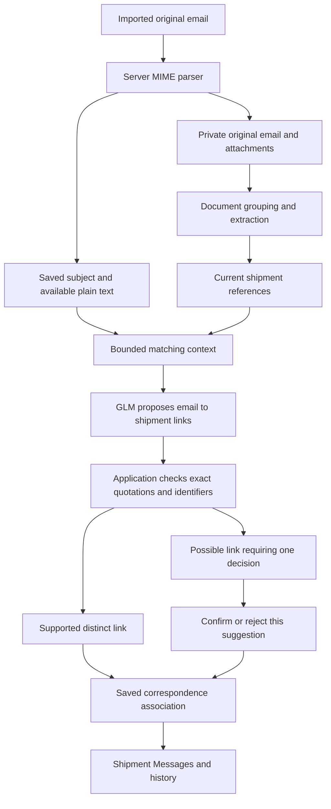

# Matching emails to shipments with GLM

AICD can associate imported emails with the shipment records already in the workspace. An email can contain new attachments, refer to an earlier document, or be a reply with no attachments. The saved association makes those messages available together in the shipment's **Messages** section.

The application currently reads saved `.eml` files. **Live Gmail synchronization is not connected.** This feature does not retrieve an inbox, send messages, create Gmail drafts, or schedule follow-ups. The fixed GLM configuration belongs to the administrator; users have no AI-provider settings.

## What the user sees

The shipment list contains an **Emails by shipment** card. Import an `.eml` file with the ordinary upload action. When GLM is configured, intake attempts a bounded matching pass after the email and attachments have been saved. The card's **Match emails with AI** action can process existing messages or resume matching later. Document vision extraction can supply additional references for a later matching pass.

Clear, independently checked links appear in the collapsed linked-email list and in the appropriate shipment's Messages section. An uncertain link asks one specific question: does this email belong to this shipment? Expand **Matching evidence** to see the original email quotation and the supporting document quotation, filename, version and page.

**Correct shipment** confirms that association. **Different shipment** rejects it. Each decision applies to one suggestion. Other questions stay open; confirmed links and rejected decisions remain available below the questions. The model cannot undo a person's prior confirmation or rejection during a later matching run.

Emails without adequate evidence stay unlinked and accessible in the card. Their original message can be downloaded. A missing match does not mean the email is unrelated; it means this implementation did not establish a sufficiently supported association.

## Two different grouping operations

Document grouping and email matching have different responsibilities:

| Operation | Input | Result |
| --- | --- | --- |
| Document grouping | The complete incoming document batch and existing shipment evidence | Documents are assigned to shipment cases before their facts fill a declaration draft. |
| Email matching | Saved email subjects/body text and current shipment document references | A correspondence link is saved between an email and one or more existing shipment cases. |

For example, a supplier may send one email containing invoices for two shipments. The document-grouping engine determines where each attachment belongs. Email matching must not move every attachment into whichever shipment the model mentions first. The message can appear in both shipments when its attachments or separately supported references justify those associations.

Conversely, a reply saying “Please use HBL ABC123456” may contain no attachment. GLM can propose an association to an existing shipment whose current document contains that reference. The application saves a correspondence link; it does not create an empty shipment or fill declaration values from the email sentence alone.

Historical folders imported as the **Samples** collection are excluded from automatic email matching. Their example references must not attract an operational email away from the active shipment. Completed cases are also excluded from new AI matching.

## How the pipeline works

1. **Parse and preserve the message.** The backend parses the original MIME email independently of the browser. It saves its message ID, sender, subject, timestamp, available plain body text (or a bounded, non-rendered HTML-to-text fallback), reply headers and attachment relationships. It stores the original bytes privately. Email body text is bounded to 50,000 characters in the saved record. Original HTML is not executed in the interface; displayed content is plain text.
2. **Prepare shipment facts.** The planner collects allowed references from active, non-reference-only documents and their current extraction candidates. It includes invoice numbers, House B/L or unqualified B/L references, contract numbers and container numbers. Each fact retains its document ID, version, page and source quotation.
3. **Select relevant context.** The application looks for exact reference tokens in the email subject or body. Only potentially relevant shipment facts are included in the model request. A matching sender name, familiar company, vessel, reply header or subject wording by itself does not establish a shipment link.
4. **Ask GLM for structured proposals.** The server sends bounded text to the same Z.ai endpoint used by extraction. This stage does not send additional page images: it uses the references already obtained from document extraction, which may include GLM vision. The model returns JSON identifying email IDs, shipment IDs and the evidence supporting each proposal.
5. **Validate again in ordinary code.** The model's IDs must belong to the selected records. Its email quotation must occur in the submitted email text, its document quotation must match the permitted source evidence, and the quoted reference must be present as a complete token. Invented evidence, a different document version or a conflicting reference rejects the proposal. A second check runs against current workspace evidence before saving.
6. **Save a link or a question.** A reliable, unambiguous House B/L or unqualified B/L reference can justify automatic linking. An invoice number corroborated by a distinct contract or container reference can also qualify. A single weak reference, uncertain OCR, an identifier reused across open cases or a truncated comparison remains a review suggestion. The model does not decide its own confidence threshold.

Matching quotations is a necessary check, not proof that every source document is correct. The application also checks reference roles and ambiguity because a number can be accurately quoted from the wrong shipment or interpreted as the wrong kind of identifier.

## What gets saved and why

An `EmailRecord` is the saved message metadata and text. Its `shipmentMatches` array contains the additional AI/human associations. Each `EmailShipmentMatch` stores a stable ID, shipment ID, status, supporting quotations, model, timestamps, and whether the decision came from AI or a person.

This separation preserves several useful distinctions:

- The original email remains unchanged when a person rejects a proposed association.
- An original attachment relationship remains available independently of an AI suggestion.
- Replacing or moving a supporting document can make a match stale. It then stops appearing as a current AI link until its evidence is established again.
- Existing correspondence remains readable after a shipment is archived while its source proof remains intact. Archived cases are excluded from new matches.
- A new competing reference invalidates an automatic link; an AI rerun that omits an earlier link retains it as a review question.
- Human decisions survive a rerun. A model response cannot silently turn a rejected association into an accepted one.
- An email association does not mark declaration fields reviewed, approve a shipment, or submit anything to ECUS.

The save uses the workspace's revision check. If another request changes the workspace while GLM is processing, the result cannot silently overwrite the newer state. Original intake is committed before the matching attempt, so a matching failure does not discard uploaded email or attachments.

## Bounds, configuration and failure behavior

| Limit | Current value |
| --- | --- |
| Emails in one provider matching pass | 8 |
| Subject text per email sent to the model | 500 characters |
| Body text per email sent to the model | 6,000 characters |
| Relevant shipment cases in one model context | 24 |
| Total matching context | 64,000 characters |
| Proposals returned | At most 48 |
| Evidence entries per proposal | At most 6 |
| Provider output | At most 6,000 tokens and 256 KiB |
| Matching timeout | 90 seconds |
| Workspace provider allowance | 6 calls per minute, shared with document extraction |

These limits are fixed application controls, not customer settings. The response reports omitted emails and limited context; processing one batch does not imply that the entire inbox was checked. The manual matching action prioritizes pending or stale matches and rotates by previous processing time. Use it again for further batches when needed. The local launcher queues matching after document jobs finish, even with the browser closed. An unchanged email/evidence fingerprint is processed once; changed evidence creates a new job. Failed jobs wait for deliberate retry. Hosted standalone matching remains request-driven.

The administrator uses the existing server-only `ZAI_API_KEY` and optional `ZAI_MODEL`; the only supported live model is `glm-5.3-flash`, with low reasoning effort and no Moonshot fallback. The endpoint is fixed to `https://api.z.ai/api/paas/v4/chat/completions`. See [GLM configuration](kimi-vision.md) and [local setup](local-setup.md). There is no separate email-matching key and no reason to put an API key into a message or browser setting.

Without the key, imported originals, document grouping and existing attachment/email associations still work. AI matching remains unavailable. A rate limit, timeout or invalid provider response preserves saved originals and reports that matching needs to resume.

## Where to read the code

| File | Responsibility |
| --- | --- |
| [server-upload.ts](../lib/server-upload.ts) | Parses and preserves original email, accepts replies without attachments, commits intake and starts matching when configured. |
| [email-shipment-ai.ts](../lib/email-shipment-ai.ts) | Builds the bounded context, calls GLM, validates returned evidence and determines automatic-link eligibility. |
| [server-email-grouping.ts](../lib/server-email-grouping.ts) | Checks access/revision, applies rate limits, selects a bounded pass and commits validated results. |
| [email-grouping.ts](../lib/email-grouping.ts) | Saves match decisions, checks whether evidence is current, preserves human decisions and resolves current shipment associations. |
| [types.ts](../lib/types.ts) | Defines message records, match evidence, statuses and accepted application actions. |
| [email-shipment-matches.tsx](../components/workspace/email-shipment-matches.tsx) | Displays matching progress, uncertain questions, source quotations and collapsed history. |
| [shipment-messages.tsx](../components/workspace/shipment-messages.tsx) | Shows the current shipment's original correspondence, plain text and attachments. |

Provider tests use controlled mock responses to check exact-source validation, ambiguity, failures and bounds. Domain tests check saved links, individual decisions, stale evidence and preservation of reviewed shipment data. The document-image benchmark does not measure email-matching accuracy. Passing these checks establishes software behavior; evaluating accuracy requires real broker-reviewed email/shipment pairs once the provider is configured.
