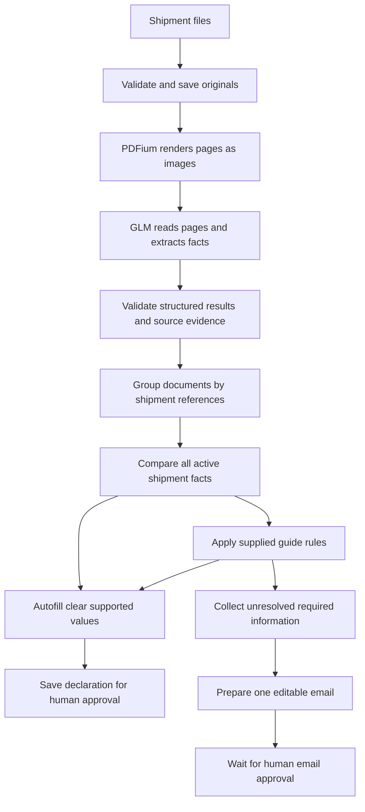

# How GLM fills a shipment draft

GLM-5.3-Flash is the only live document extractor. Historical Kimi module names and saved evidence remain for compatibility; they do not select the live provider. For a PDF, AICD makes images of the pages and asks GLM to read them. It does not first read a hidden PDF text layer or run OCR. Application code checks the returned evidence, groups related documents, compares the shipment's facts and fills the editable declaration draft.

A clearly read, source-linked value does not need a separate confirmation merely because AI read it, or because it appears in only one appropriate document. Questions are for information that is missing, unclear, inconsistent, ambiguous or affected by changed sources. For example, a clear invoice number can fill automatically. Two different gross weights for the same shipment require a question. A packing-list package count and an invoice sales quantity describe different things and must not be treated as a disagreement.

This is inference using an existing model, not training or fine-tuning GLM on your shipments. Automatically filling a draft is separate from a human approving or submitting it.

## Administrator setup

The owner sets `ZAI_API_KEY` on the server. The live model is `glm-5.3-flash`; an omitted `ZAI_MODEL` uses that default. Other live models are rejected and there is no Moonshot fallback. End users cannot change the provider or enter keys in Settings. **Settings → AI prompts → View AI prompts** shows the exact current instructions for document extraction, page labels, validation repair and email matching, along with the configured model. The panel reads the same exported strings and functions used to build live requests. `{{pageNumber}}` and `{{validationFeedback}}` mark the per-request values; source files are supplied separately. The authenticated `/api/ai/prompts` endpoint also exposes these instructions as JSON, without credentials or shipment contents.

For the local installation:

1. Stop the local server before editing its configuration.
2. Open `.aicd-local/.dev.vars` in a local editor and preserve the generated entries.
3. Add `ZAI_API_KEY=your_private_key`. Optionally set `ZAI_MODEL=glm-5.3-flash`.
4. Start `npm run local` and keep the local server running during extraction. The local reader continues when browser tabs close.

Keep the key in that private file or an administrator-managed server environment. It must not go in chat, a browser field, a `VITE_`/`NEXT_PUBLIC_` variable, source code or shell history. See [local setup](local-setup.md) for file permissions, environment precedence, disabling GLM and backups; see [standalone setup](standalone-setup.md) for the retained deployment adapter.

The fixed provider endpoint is `https://api.z.ai/api/paas/v4/chat/completions`. Page images are sent as inline base64 image content, with JSON output requested. Requests enable thinking with low reasoning effort, temperature 1 and top-p 0.95. The one shared schema/source-evidence repair retains the initial options and the same time, size, output and request-budget limits. The previous assistant response may remain in memory for that repair; reasoning content is never saved or shown in the application. See the [official GLM-5.3-Flash documentation](https://docs.z.ai/guides/vlm/glm-5.3-flash). A configured status means configuration is present; it does not prove account balance, model access or live accuracy.

## What happens to a PDF

1. **The browser prepares the upload.** It identifies files and email attachments. The server counts physical PDF pages; PDFium later checks that count and renders the pages. PDF.js and Tesseract are no longer dependencies of the extraction pipeline, and there are no OCR workers or language assets in that pipeline.
2. **The original is saved privately.** The server validates the upload and computes its SHA-256 fingerprint. A fingerprint identifies the exact bytes of the file. Related files may arrive together or in later emails; a common sender or filename alone does not prove that they belong to one shipment.
3. **The local reader prepares page images.** The local launcher uses PDFium and Sharp, while explicit manual/hosted extraction can use the browser. The reader downloads the authenticated original, checks its fingerprint, and uses PDFium to render selected physical pages as bounded JPEG images. Uploaded image documents use the same bounded image preparation path. Rendering means drawing an existing page; it does not recognize words or decide form values.
4. **The server calls GLM.** It checks the workspace, document version, original fingerprint, page number, image format and size. It sends the private page images using the server's key. It never asks GLM to fetch an arbitrary browser-supplied image URL. PDFs and images use the visual reading rather than old PDF.js/OCR text.
5. **GLM reads and extracts.** The response identifies whether each page is clear or uncertain, its document type and the factual field proposals. It does not create a full transcript of every word. The source document panel shows the original file; saved source quotations remain available in the form’s field evidence. Each value identifies its source page and quoted reading; visual values also identify a region of the page. Goods cells identify their physical row. The prompt forbids invented information and treats instructions printed in documents as source content rather than commands.
6. **Application code checks and combines the result.** It validates the JSON shape, allowed fields, page references, image evidence, quoted values and conservative normalization. Value-to-quote containment tolerates whitespace differences only: letters, punctuation, digits and order must remain unchanged and the matching span must stay contiguous. Original quotes are retained. The four invoice/contract identifier and date fields can remain document-level when GLM attaches a rowIndex only if their quote contains the relevant explicit invoice/contract number/date label; the model-supplied index is recorded in their normalization trace for audit. Currency, weights and other fields keep their scope checks. It keeps commercial buyer/seller roles separate from transport agents. Shipment references decide document grouping; the settled shipment's combined facts supply the web draft.
7. **Clear facts fill automatically.** Clear, supported values do not create routine confirmation questions. Matching readings on distinct clear GLM pages can corroborate a value; duplicated copies do not count as independent evidence. The supplied guide selects the commercial invoice for invoice fields, the contract seller for exporter identity, and appropriate transport evidence for shipping fields. Conflicting primary documents remain unresolved. Guide-derived codes require clear source facts for every dependency. Existing human corrections remain protected.

   A separate user-requested source-reconciliation policy handles exporter names and addresses when no contract is present: the invoice seller and explicitly labeled certificate exporter must agree, with a matching address and no contradictory primary identity evidence. A different secondary packing header can then be excluded from that field decision. The original readings remain intact, and the supporting name/address evidence accompanies the saved value. This selects between GLM readings; it does not introduce another extraction method.
8. **Remaining questions become one email draft.** After all active sources have complete, clear GLM readings, required missing fields and unresolved form conflicts are consolidated automatically. Repeated goods questions use row ranges. User edits are preserved, with changed suggestions offered for review. Recipient, subject and body must be saved and current before human approval. Approval becomes stale if relevant evidence or the message changes.
9. **The person approves the completed draft.** GLM cannot approve a declaration, approve an email, send email or submit to customs. Email approval is stored locally; delivery is not implemented. Current-law validation and real ECUS integration remain separate capabilities.

TXT, CSV and XML files use the same GLM-led field extraction with their raw text instead of page images. Reading text bytes for the model is file preparation; it does not independently select values for the form. Other office formats currently need a PDF export before extraction. Unsupported files remain preserved and can be replaced with a readable representation.

## Why remove PDF.js and OCR?

The initial pipeline combined three readers, which created extra low-confidence states even when a value was visible. This version follows the requested simpler approach: GLM reads the source, and ordinary code checks its structure and consistency. PDFium remains only because the vision API needs page images.

There is no OCR, PDF-text, regular-expression field extractor or heuristic fallback in the production extraction path. Normalization, validation and supplied-guide mappings operate only on GLM’s structured facts. The former parser exists only in historical regression fixtures under tests/helpers.

GLM can still read a digit incorrectly or assign a real value to the wrong field. An image region and an “uncertain/clear” label are evidence metadata, not an independent guarantee. To evaluate the tradeoff, compare results against broker-reviewed answers from representative suppliers, scans, languages, document types and known disagreements. Measure unflagged errors as well as the number of manual questions.

## Evidence, privacy and trust

Original documents, page image derivatives, GLM page metadata and field candidates are separate records. The original fingerprint identifies the file; the document version identifies the current interpretation context; an image fingerprint identifies the rendered bytes used by the model. A later document replacement cannot silently reuse the earlier evidence.

These checks identify the uploaded derivative the system used. They do not cryptographically prove that an uploaded derivative was rendered truthfully. The local reader renders originals independently of the browser; manual and hosted paths can still accept authenticated browser derivatives. The original document remains available beside the source evidence.

GLM receives no tools for email sending, ECUS, shell access or database changes. The application accepts only bounded structured output and validates it before creating internal actions. Printed instructions cannot override the workflow. The general workspace endpoint cannot accept arbitrary caller-created AI extraction results.

With GLM configured, page images and relevant text leave the Mac for Z.ai processing under the administrator's account. Source downloads exclude shipment files and keys. The implementation does not establish a new data-retention agreement with Z.ai or certify compliance with customs requirements.

## Waiting, interruption and historical data

Without a server key, originals are saved in a waiting-for-GLM state. They are not passed through PDF.js, OCR or a deterministic fallback. The website asks for administrator configuration and retains the extraction action; users are not asked to transcribe every pending page manually. Optional manual correction remains available.

The local launcher automatically scans unread originals across open import shipments every few seconds, independent of the selected shipment or an open browser. Two different originals can process in parallel, with one page per request and at most one active page per document. SQLite claims cap concurrency and prevent duplicate provider calls by competing readers. Sample source collections, reference-only originals and closed shipments are excluded. Each page records its attempts, start/completion times, elapsed milliseconds and failure status. A completed read is not automatically repeated just because its evidence remains unresolved. Provider/preparation failures stop that page for explicit retry; rate-limit responses wait one minute. Ten-minute expired leases recover process interruptions. A crash between the provider response and its saved result can still cause a repeated provider call; exact-once billing is not promised. Restarting the local server resumes pending pages. `AICD_BACKGROUND_PROCESSING=0 npm run local` pauses automatic extraction and intake email matching for inspection, preserving the provider key.

Parallel AI results re-read the latest workspace state, confirm the same active document/version/fingerprint and its current open shipment (including a regrouped destination), then apply the existing audited AI action with atomic revision checks. Conflicting commits retry only the save; they do not repeat GLM calls. Human decisions remain protected. The browser refreshes results only when it has no unsaved edits and its starting snapshot is still current. Hosted standalone deployments retain selected-shipment browser processing. After document jobs finish, the queue matches imported emails against the resulting shipment evidence. A fingerprint of the exact email and matching evidence makes each unchanged input run once, including a no-match result. New evidence creates a new matching job. Failed matching waits for deliberate retry. Matching saves recheck that fingerprint and preserve human decisions during revision conflicts. There is no live mailbox connector: automatic intake currently begins after supported files or saved `.eml` originals enter AICD.

A rejected secondary reading can stop blocking automatic questions and automatic requeues only under a supplied-guide priority rule. The latest complete diagnostics for the current document version and page must show only header `row_scope_mismatch` failures, and every affected field must have clear, agreeing current primary evidence selected by that rule. The primary evidence must come from pages without rejections. Raw rejections and their diagnostics remain retained; no rejected value is promoted into the form. Missing or incomplete diagnostics, conflicting or unclear primary evidence, failures on the primary source, and all other rejection reasons remain unresolved. Explicit page rereads stay available.

Provider calls have page, text, image-size, output and per-minute limits. The automatic reader and browser read visual documents one page per request so dense pages can finish independently. A completed response that fails the proposal schema or exact source-evidence checks may receive one shared format-repair request with the same original pages and safe validation feedback. Both calls count against the provider budget; each has a 240-second timeout and the extraction has a 480-second total deadline. Named crop corners are validated before conversion to stored rectangles; existing rectangle tuples retain their original meaning. Only facts passing strict schema and source checks are saved; unresolved rejections remain explicit per page, and an empty repair cannot mark pages complete. Previously valid facts omitted by a source repair are retained, and exact duplicate proposals do not count as failures. HTTP, network, truncated-response and timeout failures are not retried. Diagnostics expose schema paths/codes, limited numeric crop coordinates and allowlisted field/page/reason metadata, never source quotations or credentials. AI result saves rebase against the latest revision; changed source versions or closed shipments reject outdated results.

Historical sample records and human decisions remain available in the audit trail. A stale source selection can be retired automatically when clear current GLM facts agree and either its previous source is a known legacy machine reader or its saved value is semantically equivalent. The old choice is recorded as superseded; the new value remains an automatic draft, without a fabricated human review. Explicit manual corrections, materially different prior GLM choices, unclear evidence and real conflicts remain protected. Old OCR/parsing results are excluded from active autofill and labeled as history in Documents. Even historical processed-page markers cannot substitute for saved GLM page readings. Historical Kimi checks included a synthetic example covering all editable goods fields and the user-authorized original shipment behind the reported invoice issue; those results are not GLM accuracy evidence. See [validation results](validation.md) for the exact scope and remaining limitations.

## Inspect confidence, a source crop and its rule

Select any header field or goods cell in the ECUS form to open **Confidence and evidence** on the right. The panel shows the current value, each supporting reading and the cropped region of the saved page image containing its evidence. Numeric scores are GLM’s own estimates on a 0–100 scale, not calibrated accuracy probabilities. Older readings without a numeric estimate retain their high/medium/low label; no score is fabricated. Manual edits are distinguished from the source reading. On narrow screens the panel moves below the form.

**Sources / Documents** shows original PDFs and images directly, with an original-file download. PDF pages are drawn locally from verified original bytes using PDFium, with page navigation; previewing does not call GLM, extract text or run OCR. This works without an embedded browser PDF viewer. Office files can be downloaded and opened in a compatible application. There is no extracted-text tab or extraction trace in this document viewer. Select a form field to inspect its quotation, page, image region, normalization and guide basis in **Confidence and evidence**. The original file remains available alongside the form; historical local readings cannot silently supply a current value.

The user-supplied DOCX is a development reference. Selected sections and its SHA-256 are recorded in `lib/vnaccs-guide-source.json`; deterministic policies live in `lib/vnaccs-guide-rules.ts`. This includes section 1.86’s ±1 tolerance for line amount versus unit price × quantity. The reference does not establish current customs law. Embedded document instructions are never execution instructions.

Goods from different documents can be joined by a clear, explicitly printed model or goods code when it identifies one row in each document role. A similar description or the presence of only one row is insufficient. Invoice descriptions and commercial values retain their invoice authority; contradictory identities or primary invoices remain unresolved. Company punctuation and spacing are reconciled only with matching clear address or tax-ID evidence.

The form can project an explicit country name to an ISO country code, remove punctuation from an explicitly supplied HS code, and take a single explicit Incoterm from its delivery phrase. These transformations retain the original reading, crop and normalization reason. They do not infer origin from an address, classify goods or pad a short HS code. The country table in `lib/country-codes.ts` records its UNECE/UNSD sources and checksum. Long goods descriptions and evidence quotations are preserved rather than silently truncated.

## Client knowledge after a human correction

Document reading remains GLM-only. Separately, an explicit form save can remember human-supplied importer code, name, address, postal code or telephone. Each local record identifies the prior and corrected values, reason/basis, author, time and source shipment. The source correction must still be current; extraction, unchanged confirmations and applying a remembered value do not teach another copy of the same fact.

For a later shipment, an exact importer-code match takes priority. Without codes on both sides, an exact normalized company name plus address is required; conflicting known codes prevent reuse. An explicit name/address correction can retain its exact pre-correction name and address as an alias, never its old importer code. There is no fuzzy company matching or reuse between demo and real shipments. Only the newest valid matching correction per field is offered, so dismissed or already-used values do not revive earlier suggestions.

The form presents this knowledge separately from source crops and model confidence. **Apply** checks the current value and workspace revision, then saves a manual source awaiting normal declaration review. **Dismiss** skips the suggestion for this shipment. **Stop suggesting** revokes it for future suggestions, with history retained. Pending local edits must be resolved before applying a remembered value.

A remembered answer to a current automatic question blocks email approval until the person applies or dismisses it; the existing question stays visible in the draft during that decision. Changed remembered answers also invalidate relevant email approval. Nothing is automatically sent or approved.

These records stay in workspace storage and are not sent to GLM or used to train the model. Invoice numbers, dates, quantities, weights, prices, bank details and tax rates are not carried forward as defaults. Supplier facts and the combined individual/organization classification are not included. See [ECUS form behavior](ecus-ida-forms.md#remembered-client-corrections) for the complete scope.

## Where the code lives

| File | Responsibility |
| --- | --- |
| [client-intake.ts](../lib/client-intake.ts), [pdf-pages.ts](../lib/pdf-pages.ts) | Prepare files and attachments; count physical PDF pages without text extraction or OCR. |
| [client-vision.ts](../lib/client-vision.ts) | Verify authenticated originals, upload bounded page images and run resumable GLM batches. |
| [client-pdf-raster.ts](../lib/client-pdf-raster.ts), [pdf-raster.ts](../lib/pdf-raster.ts), [pdf-raster-worker.ts](../lib/pdf-raster-worker.ts) | Render PDFium page pixels in a cancelable worker with a timeout; no text extraction. |
| [vision.ts](../lib/vision.ts), [server-vision.ts](../lib/server-vision.ts) | Validate image sizes and source binding; protect private derivative storage. |
| [server-kimi.ts](../lib/server-kimi.ts), [intake-ai.ts](../lib/intake-ai.ts) | Authorize GLM extraction and apply request, source-version and revision limits. |
| [kimi.ts](../lib/kimi.ts) | Export the current extraction and repair prompts, build the provider request and validate page readings and source-backed facts. |
| [ai-prompts.ts](../lib/ai-prompts.ts), [prompts route](../app/api/ai/prompts/route.ts) | Expose the live prompt wording in Settings for authenticated workspace members. |
| [engine.ts](../lib/engine.ts), [shipment-grouping.ts](../lib/shipment-grouping.ts) | Apply results, group related documents and generate unresolved issues. |
| [shipment-autofill.ts](../lib/shipment-autofill.ts), [vnaccs-guide-rules.ts](../lib/vnaccs-guide-rules.ts) | Combine current GLM evidence and supplied-guide decisions into editable form fields. |
| [country-codes.ts](../lib/country-codes.ts) | Project exact supported country, HS and Incoterm readings into form codes while retaining raw evidence. |
| [client-case-automation.ts](../lib/client-case-automation.ts) | Resume only the selected shipment’s unread originals. |
| [source-completeness.ts](../lib/source-completeness.ts) | Decide which current source rejections still block automatic questions or requeues, using complete diagnostics and supplied-guide primary evidence. |
| [client-memory.ts](../lib/client-memory.ts) | Record explicit stable importer corrections and offer guarded, human-applied suggestions for matching clients. |
| [shipment-correspondence.ts](../lib/shipment-correspondence.ts) | Maintain consolidated local question drafts, preserve edits and require current human approval. |
| [local-config.mjs](../scripts/local-config.mjs), [local.mjs](../scripts/local.mjs) | Load administrator secrets and run the isolated local workspace. |

The pipeline does not yet implement live Gmail synchronization, background follow-ups, a verified complete mapping to ECUS5-VNACCS 2018 build 6.0.257, regulation checks or a real ECUS connection. The current result is a source-linked draft saved in the web application.
